# Установка Plexus DSH и Плексуса

Здесь по шагам показано, как поставить два плагина в DeepSeek Harness (Desktop или Web):

- **Plexus DSH** (`@plexus-dsh/bundle`). Это четыре плагина одним пакетом: счётчик окна, тёплый кэш, обрезка больших чтений и разведчик.
- **Плексус** (`@plexus-dsh/plexus`). Это команды `/plexus-*` и работники `plexus-programmer` и `plexus-analyst`.

Установка занимает пару минут, всё делается кнопками. Скриншоты сняты в русском интерфейсе, английские подписи даны в скобках. Красной рамкой обведено то, что нужно нажать.

> **Нужна DeepSeek Harness версии `0.2.2-rc.5`, ровно эта.** Плагины собраны под неё (Plexus DSH 0.1.2, Плексус 2.11.3). На другой версии DSH они установятся, но при запуске выключатся. Версию можно посмотреть в меню **DeepSeek Harness → О программе** (About). Не обновляйте DSH, пока не выйдут плагины под новую версию: см. раздел [«Если обновился DeepSeek Harness»](#если-обновился-deepseek-harness).

## Установка

Маркет плагинов в DSH пока экспериментальный. Поэтому сначала его включают, потом добавляют наш индекс и ставят оба пакета.

### 1. Откройте страницу «Плагины»

В боковой панели нажмите **Плагины** (Plugins). Внизу страницы есть раздел **Экспериментальные плагины** (Experimental plugins).

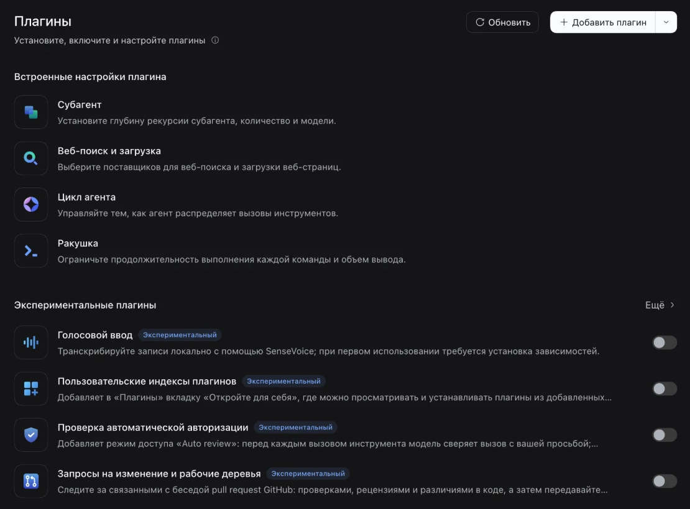

### 2. Включите пользовательские индексы

В разделе **Экспериментальные плагины** включите переключатель **Пользовательские индексы плагинов** (Custom plugin indexes). Сразу, без перезапуска, вверху появятся вкладки **Установлено** (Installed) и **Откройте для себя** (Discover).

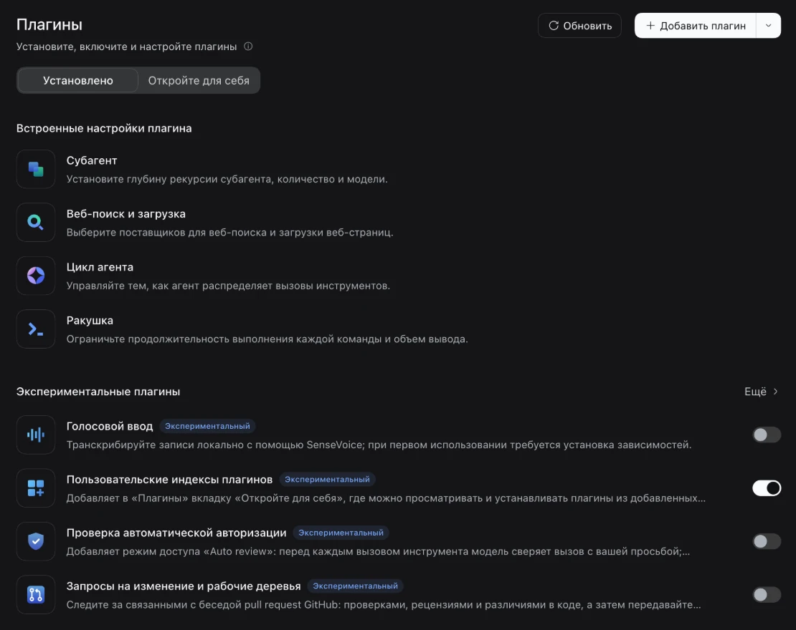

### 3. Откройте вкладку «Откройте для себя»

Пока там пусто. Нажмите **Добавить источник индекса**.

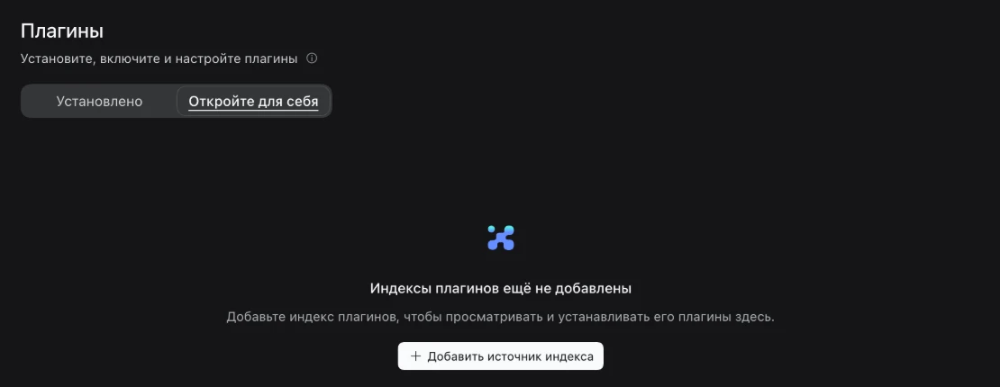

### 4. Вставьте адрес индекса

Откроется окно **Источники индекса**. Вставьте в поле адрес и нажмите **Добавить**:

```
https://raw.githubusercontent.com/AidamirKaraziev/plexus-dsh/main/market.json
```

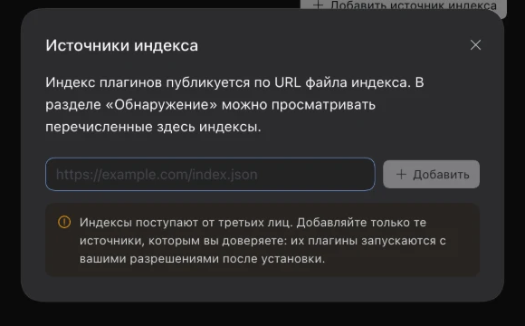

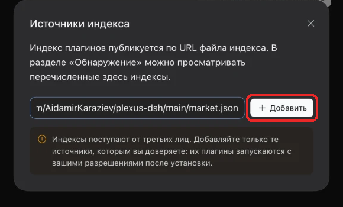

### 5. Закройте окно

Индекс появится в списке под названием **Plexus DSH**. Закройте окно крестиком.

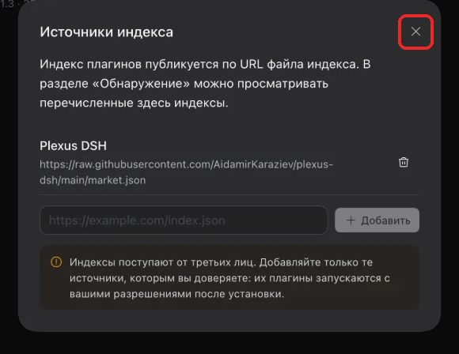

### 6. Найдите оба плагина

На вкладке **Откройте для себя** теперь два плагина: **Plexus DSH** и **@plexus-dsh/plexus**.


### 7. Установите Plexus DSH

Нажмите **Установить** (Install) у **Plexus DSH**. В окне подтверждения проверьте пакет: должно быть `@plexus-dsh/bundle@…`. Затем нажмите **Установить**.

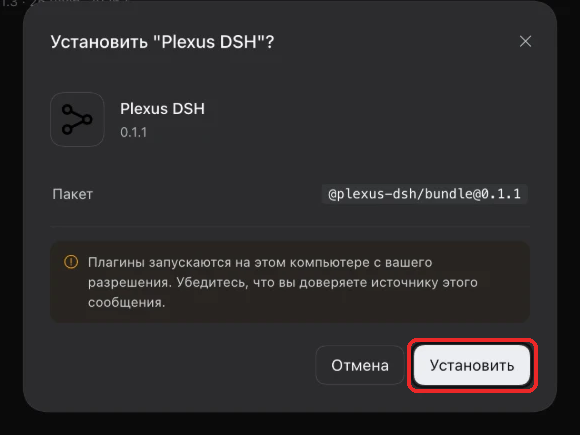

### 8. Включите Plexus DSH

Когда появится «Установлено», нажмите **Включить сейчас**.

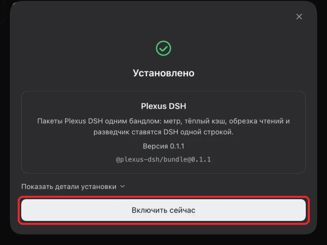

### 9. Установите Плексус

Нажмите **Установить** у **@plexus-dsh/plexus**, проверьте пакет `@plexus-dsh/plexus@…` и подтвердите.

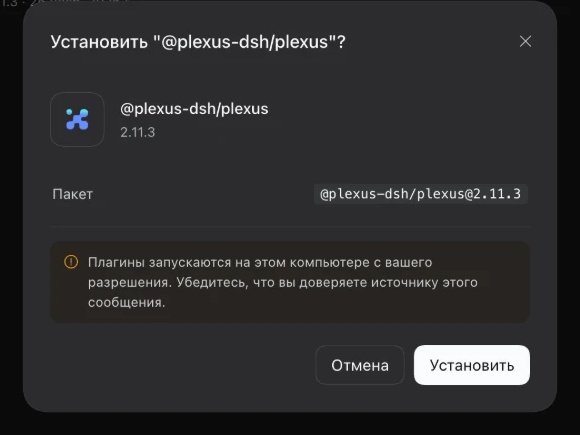

### 10. Включите Плексус

Нажмите **Включить сейчас**.

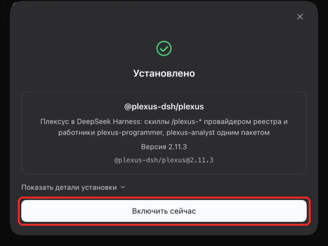

У обоих плагинов в списке теперь написано «Установлено».

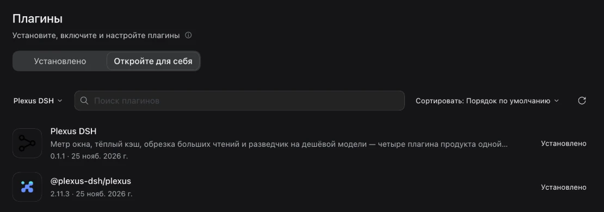

## Проверка

1. **Плагины → Установлено → Plexus DSH.** В разделе **Компоненты** должно быть «4 всего · 4 работает»: Счётчик окна, Тёплый кэш, Обрезка больших чтений и Разведчик. У всех четырёх стоит отметка «Бег» и включён переключатель.

   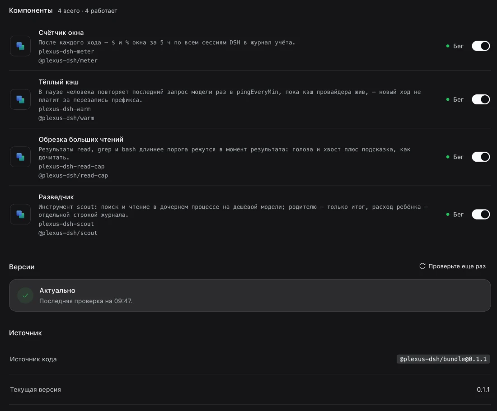

2. **Новая сессия → `/plexus-help`.** Плексус ответит списком своих команд.

   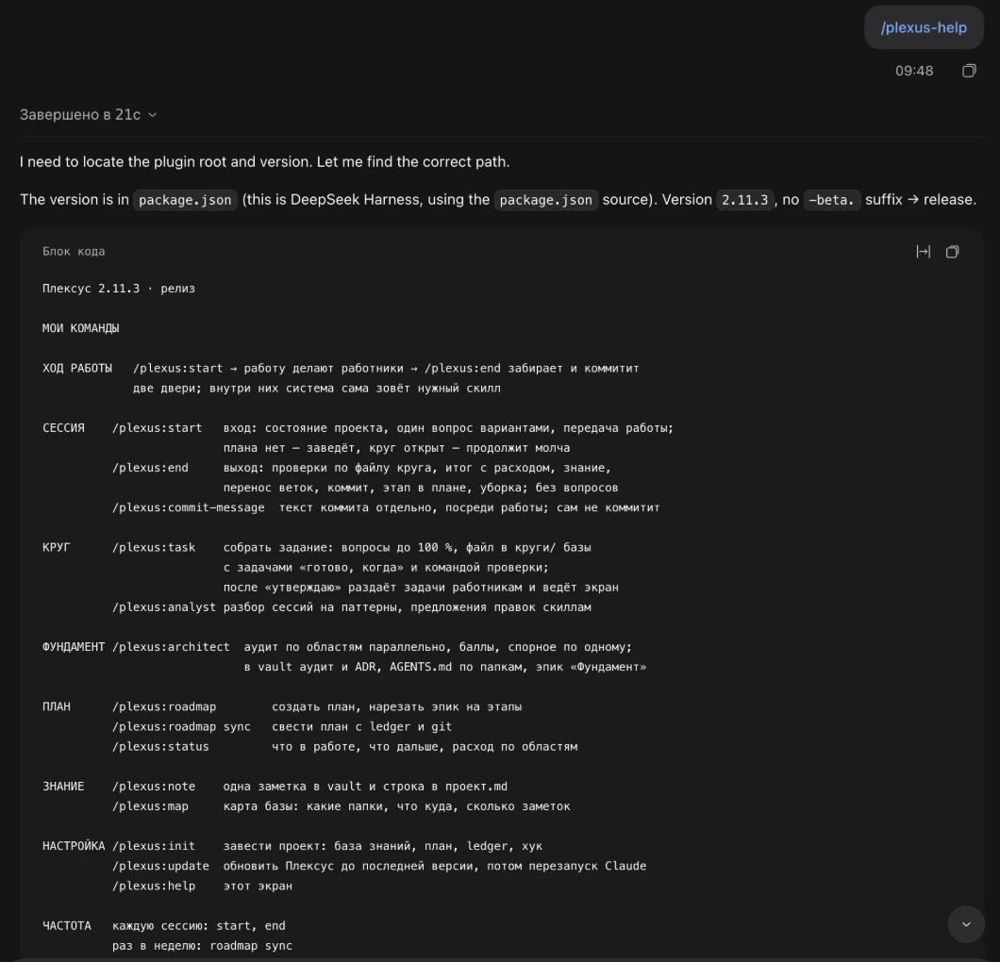

3. **Журнал учёта.** После каждого хода счётчик окна дописывает строку в `~/.plexus-dsh/usage.jsonl`. Проверить можно в терминале:

   ```bash
   tail -1 ~/.plexus-dsh/usage.jsonl
   ```

## Обновление

Сами по себе плагины не обновляются. DSH проверяет новые версии, когда вы нажимаете **Обновить** (Refresh) на странице Плагины или открываете плагин. Фоновой проверки нет.

1. Откройте **Плагины → Установлено** и выберите плагин.
2. Найдите раздел **Версии** (Versions). «Актуально» значит, что стоит последняя версия. Чтобы проверить заново, нажмите **Проверьте ещё раз**.
3. Если вышла новая версия, она появится в этом же разделе. Выберите её.

На скриншоте выше, в шаге «Проверка», раздел **Версии** виден под компонентами.

После обновления настройки плагинов и выключенные компоненты остаются как были.

Кнопка обновления на вкладке **Откройте для себя** работает только для плагинов, поставленных из Git. Наши пакеты ставятся из npm, поэтому их обновляют в разделе **Версии**.

## Если обновился DeepSeek Harness

Каждый выпуск плагинов собирается под точную версию DSH. После обновления самого DSH плагины другой версии при запуске выключаются, и это нормально: так DSH защищает себя от несовместимого кода.

Лучше всего **не обновлять DSH, пока не выйдут совместимые плагины**. Новый выпуск появится в разделе **Версии**, см. «Обновление».

Если DSH уже обновился, а нового выпуска ещё нет, плагины можно разрешить вручную. Это на ваш риск. Разрешение действует до следующего обновления DSH:

```bash
dsh plugin allow-version @plexus-dsh/bundle@0.1.2 --dsh-version <ваша версия DSH> --accept-risk
```

Номер версии DSH нужен точный, например `0.2.2`. Для Плексуса команда та же, только с `@plexus-dsh/plexus@<версия>`.

## Если не встало

Если маркет не включается или индекс не грузится, оба пакета можно поставить из командной строки. Профиль Desktop называется `desktop`:

```bash
dsh plugin --profile desktop add @plexus-dsh/bundle
```

```bash
dsh plugin --profile desktop add @plexus-dsh/plexus
```

После этого полностью закройте DSH (Cmd+Q) и откройте заново, затем пройдите «Проверку».

Если команды `dsh` нет в терминале, она лежит внутри приложения: `/Applications/DeepSeek Harness.app/Contents/Resources/runtime/cli/bin/dsh`.
